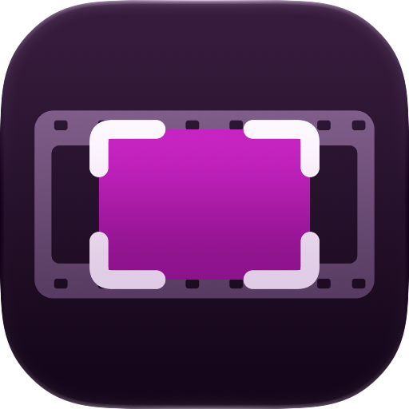

<p align="center">
  <picture>
    <source media="(prefers-color-scheme: dark)" srcset="docs/assets/stillset-icon-dark.png">
    <source media="(prefers-color-scheme: light)" srcset="docs/assets/stillset-icon-light.png">
    
  </picture>
</p>

<h1 align="center">Stillset</h1>

<p align="center">Extract screenshots from your screen recordings.</p>

<p align="center">macOS 27+ · Local processing · PNG export</p>

<p align="center">
  <a href="#get-started">Get started</a> ·
  <a href="#how-it-works">How it works</a> ·
  <a href="#development">Development</a>
</p>

Stillset detects pauses and scroll stops in `.mov` and `.mp4` screen recordings
and gathers them into a timeline. Review the captures and export the ones you
choose as original-resolution PNGs. Everything runs locally on your Mac.

## Features

- **Find the moments to capture**: Stillset detects pauses and scroll stops
  automatically. Repeat visits remain available for review.
- **Review by time or screen**: Browse captures from multiple recordings in one
  timeline, or group related screens together. Switch between unique screen
  states and every occurrence.
- **Export at original resolution**: Save selected captures as PNGs, copy their
  files, or drag them into another app.
- **Keep your recordings local**: Video processing, screen recognition, and
  screenshot export happen on your Mac.

## How it works

1. **Import.** Drop one or more screen recordings into the window.
   Captures appear as analysis progresses.
2. **Review.** Browse by chronology or screen and select the captures you need.
   Grouping keeps every occurrence available.
3. **Export.** Save your selection as PNGs, copy the files, or drag them
   into another app.

## Languages

Stillset supports English and French and follows the macOS app language preference, with English as the default and fallback language. This README uses the English interface labels. Menus, controls, accessibility labels, progress and errors are localized. Recognized text keeps the recording’s original wording; optional AI screen names follow the app language. Recent analysis metadata is reused only in the language in which it was generated.

Translations live in `App/Localizable.xcstrings` and each package’s `Sources/Resources/Localizable.xcstrings`.

## Get started

Install with Homebrew on a Mac with Apple silicon and macOS 27 or later:

```sh
brew install --cask qeude/tap/stillset
```

Stillset is signed with a self-signed certificate and is not notarized.
The Cask removes the quarantine attribute so the app can open.
Install it only if you trust this source.

### Build from source

Build from source with **macOS 27 or later** and **Xcode 27 or later**.
Make sure Xcode’s command-line tools are selected.

Open `Stillset.xcodeproj` in Xcode, select the **Stillset** scheme and
**My Mac**, then run. Or build and launch from the terminal:

```sh
./script/build_and_run.sh
```

The app is built at `dist/Stillset.app` with ad-hoc signing.
A development team is not required.

### Optional AI refinement

Use **Refine with AI…** to refine ambiguous screen names and groups.
This requires Apple Intelligence enabled on a supported Mac.
Automatic analysis works independently of Apple Intelligence.

### Current limitations

Recognition and grouping are experimental; review the captures before exporting.
Sessions are kept while the app is open and are not restored after relaunch.

See the [usage guide](docs/usage.md) for selection, export options,
analysis controls, and local caching.

## Development

- `App/`: native app entry point and commands.
- `Packages/Core/`: decoding, analysis, models and PNG export, independent of SwiftUI.
- `Packages/Features/`: app state and SwiftUI screens.
- `Stillset.xcodeproj`: native project using both local packages.

Run the automated suites:

```sh
swift test --package-path Packages/Core
swift test --package-path Packages/Features
```

Tests generate synthetic inputs and do not need private recordings or an available Apple Intelligence model. GitHub Actions builds the app and runs both suites on the macOS 27/Xcode 27 preview runner. See [testing and profiling](docs/testing.md) for optional checks and [analysis internals](docs/analysis.md) for the matching policy.

## Contributing

See [CONTRIBUTING.md](CONTRIBUTING.md). Report bugs with the [issue form](https://github.com/qeude/Stillset/issues/new/choose) and vulnerabilities through [SECURITY.md](SECURITY.md).

## License

[MIT](LICENSE).
